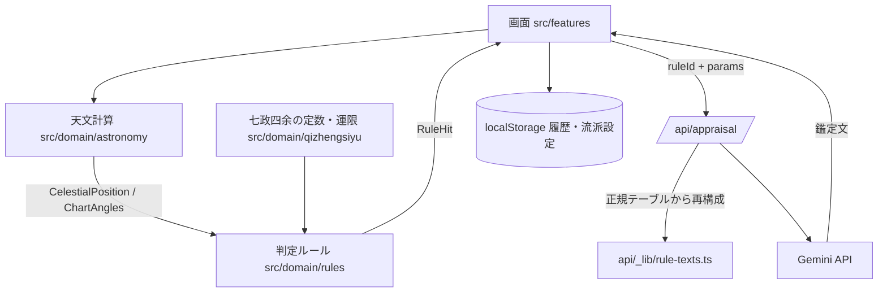

# 七政四余・命盤作成／鑑定アプリ システム設計書

実装の現状を記した開発者向けの文書です（2026-11-16 更新）。利用者向けの解説は
`src/content/guide.md`、作業上の落とし穴は `CLAUDE.md` にあります。

## 1. 全体像

生年月日・出生時刻・出生地から七政四余の命盤を計算・表示し、ルール判定の結果から
日本語の鑑定文を生成する Web アプリです。「天文計算」「判定ルール」「文章生成」の三層を分け、
鑑定結果には必ず根拠と出典を添えます。

命盤の計算と判定は**すべてブラウザ内**で行います。サーバーが担うのは AI 鑑定文の生成だけで、
出生データそのものはサーバーへ送りません（送るのは判定結果のルールIDと限定パラメータのみ）。

## 2. 技術構成

- フロントエンド: React 19 / TypeScript / Vite / Tailwind CSS 4（PWA 対応）
- 天文計算: astronomy-engine（MIT ライセンス）
- AI 鑑定: Gemini API。本番は Vercel のサーバーレス関数（`api/appraisal.ts`）、
  ローカルは Express（`server.ts`）。どちらも `api/_lib/appraisal-core.ts` を呼ぶ
- 保存: ブラウザの localStorage のみ。データベース・利用者認証はない
- テスト: vitest（`src/**/*.test.ts` と `api/**/*.test.ts`）。CI で型チェック・テスト・ビルドを実行

## 3. 実装済みの機能

- **天文計算**: 七政（日月五星）の視位置と順逆、羅睺・計都（平均／真交点）、月孛（平均／真遠地点）、
  紫氣（大統暦法）、上昇点・天頂、昼夜（太陽高度）
- **命盤の骨格**: 十二次、距星実測の二十八宿と入宿度、命宮・命度、人事十二宮（整宮制）、
  命主・命度主、身主・身宮・身度主
- **判定**: 廟旺、星宿の五行生剋、強宮・弱宮、三方四正の会合と地支の六合、格局、
  昼夜の喜忌、恩星・難星、化曜、神殺、大限・小限・流年
- **入力**: 座標からのタイムゾーン自動判定（夏時刻・地方平均時を含む）、出生時刻不明への対応
- **出力**: 円形の命盤（SVG）、星曜位置表、会合表、運限の表、AI 総合鑑定、印刷
- **履歴**: ローカル保存、ファイルへの書き出し・取り込み

## 4. データモデル

| 型 | 置き場所 | 内容 |
|---|---|---|
| `BirthInput` | `astronomy/types.ts` | 生年月日、時刻とその精度、緯度経度、UTC オフセット、夏時刻、性別 |
| `CelestialPosition` | 同上 | 星曜の ID・名称・命盤座標系での黄経・黄緯・順逆 |
| `ChartAngles` | 同上 | 命度（`ascendant`）、天頂、宿境界のずれ（`mansionOffset`）、昼夜（`isDaytime`） |
| `SchoolConfig` | `qizhengsiyu/schoolConfig.ts` | 流派設定（§6） |
| `RuleHit` | `rules/types.ts` | 判定結果。題・解釈文・根拠・出典・ルールセットの版・API へ送る `params` |
| `AppraisalRecord` | `storage/appraisalStore.ts` | 履歴。入力、判定結果、鑑定文、保存時の `schoolConfig` と `targetYear` |

## 5. 天文計算の流れ

1. 現地時刻と UTC オフセット（夏時刻なら +1 時間）から UTC を求める。
2. astronomy-engine で地心の視位置を求め、当日春分点基準の黄経にする。
3. 流派設定のアヤナムシャを引いて、命盤座標系の黄経にする。
   - Lahiri: J2000 で 23.857°。Fagan/Bradley: 1950年1月1日に 24.04204°。
     どちらも IAU 2006 の一般歳差で出生日へ移す。
4. 二十八宿は、距星の J2000 座標から作った Lahiri 恒星黄経の境界表で判定する。
   命盤が他の座標系のときは `mansionOffset` で境界表の座標へ戻して照合する。
5. 命宮は流派設定に従い、実測の上昇点か、太陽安命法（卯時に太陽の宮を命宮とし、一時辰ごとに一宮）で決める。
6. 紫氣は『明史』暦志・大統暦法「步四餘」の定数による。同じ節の月孛・羅睺の定数を同じ手順で解くと
   実際の位置に約 1.4° 以内で一致することを検算している（`astronomy-engine-provider.ts` に記載）。

## 6. 流派設定（`SchoolConfig`）

流派による違いは計算式に埋め込まず、設定で切り替えます。

| 項目 | 選択肢 |
|---|---|
| 黄道体系 | 恒星黄道（Lahiri／Fagan／任意の値）、移動黄道 |
| 安命法 | 太陽安命法、実測の上昇点 |
| 時辰の基準 | 真太陽時、標準時 |
| 羅睺・計都の割当 | 宋明式（羅睺＝降交点）、印度・時憲式（羅睺＝昇交点） |
| 交点・遠地点 | 平均位置、真位置 |
| 紫氣 | 大統暦法、算入しない、旧試験式（履歴の再現用） |
| 大限の方式 | 『果老星宗』十二宮年分歌、陽男陰女・一宮十年 |
| 年齢の数え方 | 数え年、満年齢 |

履歴は保存時の設定を持ち、開くときはその設定で計算します。後から足した項目が無い古い履歴は、
当時の挙動になる値で補います（`storage/schoolConfigStore.ts`）。

## 7. 判定ルールの構造

ルールは二か所に分かれています。両方を直さないと API が 400 を返します（`round-trip.test.ts` が検出）。

- **判定条件**: `src/domain/rules/rule-sets/mvp-rules.ts`。命盤から条件を評価し、ルールIDと
  限定パラメータ（宮名・宿名・星曜名など）を作る TypeScript のコード。
- **文面と検証**: `api/_lib/rule-texts.ts`。ルールIDとパラメータから、題・解釈文・根拠・出典を
  組み立てる正規テーブル。パラメータはすべてホワイトリストで検証する。

画面の表示も AI への入力も、この正規テーブルから作ります。API はルールIDとパラメータしか
受け取らないので、任意の文章を AI に渡す経路がありません。

出生時刻が不明な命盤では、命宮から導くルール（`requiresBirthTime`）を評価しません。
出生日のうちに落宮・落宿が変わる星曜も判定から外します。

## 8. AI 鑑定 API

- `POST /api/appraisal`。本文は `{ hits: [{ ruleId, params? }] }`（最大 40 件）。
- 入口（`api/appraisal.ts`）で Origin の許可リストと IP ごとの簡易レート制限を掛ける。
  レート制限はインスタンス内のメモリによるもので、厳密ではない。
- 失敗は必ず 2xx 以外で返す（成功扱いにすると、エラー文が鑑定文として保存されるため）。

## 9. 検証

- **単体テスト**: 時刻換算、宿・宮の境界、会合、運限、ルールごとの判定とパラメータ検証、履歴の保存。
- **回帰基準**: 基準命盤（1988-08-15 14:30 東京）の全星曜の位置。意図して計算を変えたら根拠を書いて更新する。
- **外部基準**: JPL Horizons の七政位置と真交点、Meeus の平均交点・平均遠地点、ラヒリの定義、
  スイス・エフェメリスの Fagan/Bradley 定義値、古典の歌訣（化曜・神殺・昼夜・恩難など）。
  こちらが落ちたら計算側を疑う。
- **往復テスト**: エンジンが出した判定結果を、そのまま API の検証に通す。

## 10. 出典

| 対象 | 出典 |
|---|---|
| 昼夜の喜忌、恩星・難星、身主、強弱宮、廟（楽宮）・旺、化曜、神殺、大限の年分歌と童限、木星の強宮 | 『張果星宗』（殆知閣のテキスト。簡体字で欠字・誤字がある） |
| 紫氣の定数と算法 | 『明史』巻35・36 暦志（中国語版ウィキソース。校正前の版で、立成の表は省略されている） |
| 二十八宿の距星と座標 | 清・時憲暦の距星同定、SIMBAD の ICRS J2000 座標 |
| 天体位置の検算 | JPL Horizons、Meeus『Astronomical Algorithms』 |

原文で確認できなかったものは、ルールの出典欄に「通説（典拠未確定）」と書いています。
具体的には、四余の吉凶の意味、星宿の五行生剋の解釈、陥・落（廟・旺の対宮）、
身宮を月の在る宮とすること、格局、流年の読み方、数え年、天乙貴人・駅馬・羊刃の意味です。

## 11. 実装していないもの・今後の調査事項

- 四余の廟旺、喜宮・殿垣・升殿（歌訣の本文に乱れがあり、表を確定できていない）
- 文昌など、歌訣の本文に揺れのある神殺
- 流年干による化曜（原文で確認できたのは生年干への適用だけ）
- 月運・日運、行限の度数による細かい推算
- 紫氣の宿ごとの零分（立成の表が手に入れば等速の近似をやめられる）
- 時辰で昼夜を分ける流儀（現在は太陽高度のみ）
- クラウド保存、利用者認証、複数端末での同期

## 12. ライセンス上の注意

Swiss Ephemeris は GPL と商用のデュアルライセンスのため使っていません。天文計算は
`EphemerisProvider` インターフェースの裏に置いてあり、実装を差し替えられます。
